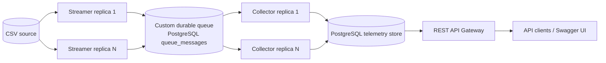

# Architecture and design

## Component view

Streamer, Collector and API are separate Go processes. The queue is implemented in Go and persisted in PostgreSQL tables; PostgreSQL is not a third-party broker. No Kafka, RabbitMQ, ZeroMQ or other external MQ is used.

## Scaling and delivery

- Up to 10 Streamers share a `source_cursors` row. `SELECT ... FOR UPDATE` serializes byte-offset allocation. Queue insertion and cursor advancement commit together.
- Up to 10 Collectors claim work with `FOR UPDATE SKIP LOCKED`. Claims have a visibility lease; expired leases are reclaimable after a crash.
- Delivery is at-least-once. Persistence is idempotent on unique `message_id`, then the Collector acknowledges the queue message. A crash after persistence but before ack causes safe redelivery.
- Transient failures retry with exponential backoff. After max attempts, messages remain in `dead` status for inspection.

## Timestamp semantics

CSV `timestamp` is retained as `source_timestamp`. Streamer adds `streamed_at` when publishing. Collector assigns `processed_at` in UTC when consuming for persistence. API orders and filters inclusively against `processed_at`.

## Data model

- `source_cursors`: per-source byte offset and header offset.
- `queue_messages`: payload, status, attempts, availability, lease owner/deadline and last error.
- `gpu_inventory`: one row per globally unique GPU UUID. Hostname plus GPU index is not globally unique.
- `telemetry_records`: one row per CSV datapoint, including metric/value and all timestamps.

Indexes cover queue availability, expired leases, GPU host/index and telemetry GPU/processing-time access.

## Failure handling

| Failure | Behavior |
|---|---|
| Streamer exits before transaction commit | Message and offset roll back together |
| Collector exits while holding claim | Lease expires and message is claimable again |
| DB write fails | Nack with exponential delay |
| Duplicate delivery | Unique message ID makes persistence idempotent |
| Max retry reached | Queue row becomes dead; inspect `last_error` |
| API DB unavailable | `/readyz` returns 503 |
| SIGTERM | Context cancellation and HTTP graceful shutdown |

## Observability and security

All services emit structured JSON logs to stdout. API exposes `/healthz`, `/readyz`, and a minimal Prometheus text endpoint `/metrics`. Production should add queue depth/age, retry/dead-letter counts, throughput, API latency and DB pool metrics.

Containers run non-root with privilege escalation disabled. Kubernetes mounts database credentials from a Secret. Production DB connectivity should use TLS, private networking, least-privilege roles, network policies and an external secret manager. Compose credentials are local-development only.

## Trade-offs

The cursor serializes offset allocation for one source, a simple and deterministic trade-off for this exercise's maximum of 10 Streamers. Multiple files require distinct source IDs. Replacing a dataset while retaining its source ID is unsupported; use a new ID.
